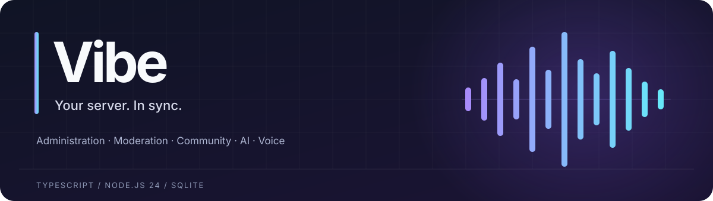

<p align="center">
  
</p>

<p align="center">
  <strong>Your server’s tools, conversations and community—in one place.</strong>
</p>

<p align="center">
  <a href="#quickstart">Get started</a> ·
  <a href="docs/RUNNING_VIBE.md">Use Vibe</a> ·
  <a href="docs/CAPABILITIES.md">Capabilities</a> ·
  <a href="docs/ARCHITECTURE.md">Architecture</a> ·
  <a href="docs/OPERATIONS.md">Deploy</a>
</p>

<p align="center">
  
  
  
</p>

Vibe is a self-hosted Discord bot with typed server actions, configurable moderation, community workflows, OpenAI assistance and consent-based voice. It runs as one Node.js process with SQLite and bounded workers for expensive jobs. Optional integrations stay unavailable until their required configuration is supplied.

**Verified snapshot · October 29, 2026:** 697 registered actions, 909 mapped requirement items and **1,304 passing tests**. Requirement items overlap; they are not 909 separate commands. The [capability audit](docs/CAPABILITIES.md), [action schemas](docs/actions.json) and [verification record](docs/VERIFICATION.md) show the implementation, setup requirements and checks behind these numbers. This snapshot does not guarantee access to every live Discord or provider feature.

## What Vibe brings

| Area                      | Built for                                                                                                                                                                         |
| ------------------------- | --------------------------------------------------------------------------------------------------------------------------------------------------------------------------------- |
| **Server administration** | Channels, roles, members, layouts, reviewed changes and permission-aware tools.                                                                                                   |
| **Community**             | Personalized [welcome embeds](docs/WELCOME_MESSAGES.md), tickets, reminders, FAQ, XP, groups and event workflows.                                                                 |
| **Moderation**            | Configured spam-burst removal, explicit-content checks, historical message cleanup and private case outcomes. An optional honeypot rule attempts to ban accounts that post there. |
| **AI assistance**         | Natural-language requests, attachment analysis, private knowledge and typed actions grounded in the current server.                                                               |
| **Voice**                 | Local Whisper transcription, name-addressed requests, related follow-ups, streamed Realtime replies and private transcripts.                                                      |
| **Files and media**       | Bounded image, PDF, Office and audio/video processing, plus optional provider integrations.                                                                                       |

Ordinary explicit requests run directly in `CONFIRMATION_MODE=smart`. Destructive or privileged changes get one expiring preview. Say **confirm** in the same conversation, or use `/confirm`, to approve real pending work. Current permissions and role hierarchy are checked again before execution. [How confirmations work →](docs/CONFIRMATIONS.md)

## Quickstart

### 1. Prepare the host

Install **Node.js 24.17+ within 24.x**, **pnpm 11.25.0**, and **FFmpeg/ffprobe** on `PATH`. Use a host that stays awake and connected; Discord voice also needs outbound UDP.

From this project’s directory, run the setup helper for your platform:

| Windows PowerShell | Linux shell     |
| ------------------ | --------------- |
| `.\SETUP.cmd`      | `sh ./setup.sh` |

Setup installs locked dependencies, creates or updates the local configuration without replacing existing values, runs offline checks, builds the bot and prepares the selected local voice model. Model preparation downloads public model assets when local voice transcription is enabled; it does not require an OpenAI key.

<details>
<summary>Prefer individual commands?</summary>

```sh
npm install --global pnpm@11.25.0
pnpm install --frozen-lockfile
pnpm configure
pnpm check
pnpm voice:prepare
```

`pnpm configure` creates `.env` from the provided example when absent and adds missing fields while preserving existing values. After configuration, use `pnpm run doctor` and `pnpm start`.

</details>

### 2. Configure Discord and AI

Keep real credentials **only in your local `.env`**:

```dotenv
DISCORD_TOKEN=
OPENAI_API_KEY=
```

One Discord bot token powers the bot; one OpenAI key powers its configured AI services. Non-AI Discord features can run without the OpenAI key. Use `.env.example` as the configuration reference; leave unwanted optional credentials blank. Changing environment settings requires a restart. Some integrations also need provider-side grants, a public callback or an enabled server policy. [Optional setup →](docs/OPTIONAL_SETUP.md)

In the [Discord Developer Portal](https://discord.com/developers/applications), install the app with `bot` and `applications.commands`. Grant the permissions required by your chosen features. Position Vibe’s highest role above roles and members it must manage; Administrator does not bypass Discord’s role hierarchy.

Enable privileged intents in **both** the Portal and `.env` when needed: `ENABLE_MEMBERS` for joins/welcomes, `ENABLE_MESSAGE_CONTENT` for passive message features, and `ENABLE_PRESENCES` for presence events. Use `DISCORD_GUILD_IDS` to restrict accepted servers. See [deployment acceptance](docs/OPERATIONS.md#deployment-acceptance) for the complete checklist.

### 3. Check and start

```sh
pnpm run doctor
pnpm start
```

Slash commands synchronize after connection. Start with `/help`, `/status` or `/ask prompt:…`. `pnpm run doctor --live` performs read-only authentication/model-visibility checks; it does not perform paid generation. Complete the live acceptance checks for your actual permissions, voice connection and enabled services.

For Docker, configure `.env`, then use `docker compose up --build -d`. The image includes FFmpeg, prepares the selected local voice model and runs as an unprivileged user with persistent SQLite storage. [Hosting, backups and rollback →](docs/OPERATIONS.md)

## Talk to Vibe

| Entry point                                       | Use it for                                                            |
| ------------------------------------------------- | --------------------------------------------------------------------- |
| `/help search:…`                                  | Find an action or command.                                            |
| `/schema name:…`                                  | Inspect exact inputs and required permissions.                        |
| `/action name:… input:{…}`                        | Execute a typed request; larger JSON can use `input_file`.            |
| `/ask prompt:…`                                   | Ask privately, include an attachment or request an authorized change. |
| A mention or reply to Vibe                        | Continue a scoped public conversation using public-safe tools.        |
| `/confirm`, `/cancel`                             | Approve or cancel pending work in its original context.               |
| `/join`, `/consent`, `/stop`, `/leave`, `/revoke` | Join voice, grant your own listening consent or stop participation.   |
| `/forget`                                         | Erase your saved AI context and reset your voice conversation state.  |

Voice requires **each speaker’s explicit consent**. New requests use Vibe’s name; brief relevant follow-ups can continue the active turn. Transcripts go only to the configured private transcript channel. Local transcription checks speech on the host; choosing OpenAI transcription instead uploads consented captured utterances, including wake-name checks. [Voice guide →](docs/VOICE.md) · [Local transcription →](docs/LOCAL_TRANSCRIPTION.md)

## Explore the project

| Start here                                                                                  | Go deeper                                                              |
| ------------------------------------------------------------------------------------------- | ---------------------------------------------------------------------- |
| [Running Vibe](docs/RUNNING_VIBE.md)                                                        | Commands, public/private chat and everyday use.                        |
| [Architecture](docs/ARCHITECTURE.md)                                                        | Source layout, authorization, voice flow, state and worker boundaries. |
| [Welcome messages](docs/WELCOME_MESSAGES.md)                                                | Avatars, templates, member counts and duplicate protection.            |
| [Automatic moderation](docs/AUTOMATIC_MODERATION.md)                                        | Spam, text/image policy, honeypots and historical cleanup.             |
| [Community workflows](docs/COMMUNITY_AND_AUTOMATION.md)                                     | Support, approvals, relays and automation.                             |
| [AI conversations](docs/AI_CONVERSATIONS.md) · [Knowledge](docs/KNOWLEDGE.md)               | Scoped context, tools and private retrieval.                           |
| [Files](docs/FILES.md) · [Media](docs/MEDIA.md) · [Audio/video](docs/AUDIO_MEDIA.md)        | Supported formats, bounds and processing.                              |
| [Optional services](docs/OPTIONAL_SETUP.md) · [Integrations](docs/OPTIONAL_INTEGRATIONS.md) | Accounts, credentials and deployment setup.                            |
| [Operations](docs/OPERATIONS.md) · [Verification](docs/VERIFICATION.md)                     | Acceptance, capacity, recovery and recorded results.                   |

## Keep configuration private

`.env`, runtime databases, logs, recordings, backups, model caches and local service manifests belong on the host, outside source publication. `.env.example` and `config/*.example.json` contain shareable configuration templates. SQLite and backups can contain private conversations, documents, reports and configured records; protect access to them. [Privacy and retention →](docs/OPERATIONS.md#data-and-retention)

Optional dashboards, account linking, plugins and fixed host tasks are separate opt-ins. Plugins execute as trusted local code; review them before enabling. AI tools use the typed action registry rather than arbitrary shell or REST access.

## Verify and package

```sh
pnpm check
pnpm audit --prod --audit-level high
pnpm capabilities
pnpm package:portable
```

`pnpm check` runs type checking, tests, production build, compiled smoke checks and formatting. The portable ZIP includes source, docs/assets, lockfiles, scripts and configuration examples; it excludes credentials, runtime data, model weights and platform-specific dependencies. Install dependencies and prepare the model on the destination host.

Use **one running bot process per SQLite database**. Offline tests and included CI/Docker configuration complement live acceptance; they do not establish final token validity, provider billing/access or Discord UDP connectivity.
