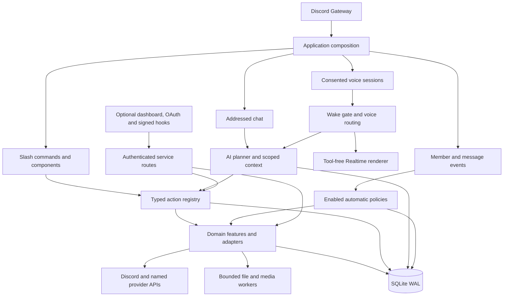
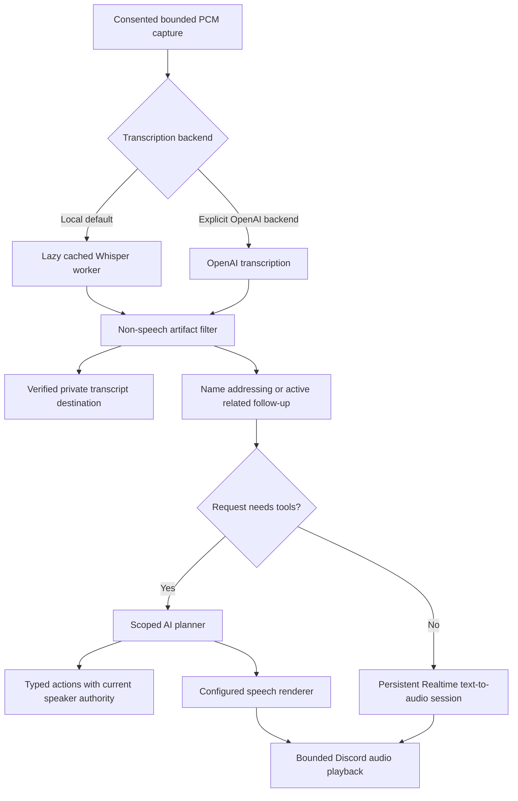

# Architecture

Vibe is a TypeScript modular monolith on Node.js 24. One primary process owns the Discord Gateway connection, application services and a local SQLite database. Expensive media/document work and local speech recognition run in bounded workers. Optional HTTP surfaces and companion processes are enabled independently.

This design keeps installation portable and lets server tools share the same authorization, persistence and delivery rules. It does not require Redis, an external vector store or a fleet of workers. Running multiple primary processes against one database, adding sharding or distributing the scheduler requires a separate ownership/coordination design.

The **October 30, 2026 verification snapshot** records 699 registered actions, 909 mapped requirement items and 1,388 passing tests. Counts describe that checked build; account access and production acceptance remain separate. See [capabilities](CAPABILITIES.md) and [verification](VERIFICATION.md).

## Runtime map

| Location                                                                         | Responsibility                                                                                               |
| -------------------------------------------------------------------------------- | ------------------------------------------------------------------------------------------------------------ |
| [`src/main.ts`](../src/main.ts), [`src/app.ts`](../src/app.ts)                   | Load configuration, compose services, bind events and manage startup/shutdown.                               |
| [`src/core/`](../src/core/)                                                      | Storage, fresh permissions, action dispatch, confirmations, quotas, paths and shared work budgets.           |
| [`src/discord/`](../src/discord/)                                                | Command definitions, interaction/personal routes, payload presentation and native Discord actions.           |
| [`src/features/`](../src/features/)                                              | Domain services: community, support, AI, layouts, games, files, policies and durable workflows.              |
| [`src/moderation/`](../src/moderation/)                                          | Local content rules, bounded classification, automatic enforcement and requested history cleanup.            |
| [`src/voice/`](../src/voice/)                                                    | Conversation gates, transcription, Realtime transport, PCM conversion, privacy checks and recording support. |
| [`src/integrations/`](../src/integrations/), [`src/services/`](../src/services/) | Named providers, account/credential resolution and optional service contracts.                               |
| [`web/`](../web/)                                                                | Optional browser surfaces built with the application.                                                        |
| [`src/host-agent/`](../src/host-agent/), [`src/monitor/`](../src/monitor/)       | Separately configured fixed-task and uptime-monitor companions.                                              |

## Actions and authority

An explicit command, addressed chat request or consented voice request receives server-created provenance bound to the current user, guild and channel. JSON input and provider output cannot manufacture that internal proof. The AI planner discovers typed capabilities and submits structured arguments; it does not receive an unrestricted shell or generic Discord REST tool.

The registry validates Zod inputs, checks feature/action policies and any configured access gates, then refreshes requester/bot membership and permissions. Resource adapters apply the relevant channel/thread access and role/member hierarchy checks. Permissions are checked again when a pending action is confirmed, including after a role or policy change.

```mermaid
flowchart LR
  Request[Current human request] --> Schema[Strict schema]
  Schema --> Policy[Feature and action policy]
  Policy --> Access[Fresh permissions and hierarchy]
  Access --> Decision{Confirmation policy}
  Decision -->|Ordinary explicit request in smart mode| Execute[Execute typed action]
  Decision -->|Privileged or destructive change| Preview[Persist exact expiring preview]
  Preview --> Staff[Private bot-confirmations channel]
  Staff --> Confirm[Human reviewer with role above Vibe]
  Confirm --> Recheck[Recheck requester and reviewer then claim once]
  Recheck --> Execute
  Execute --> Receipt[Actual result and audit metadata]
```

`smart` is the application default. `always` requests a preview before every write. Required previews and buttons go only to the dedicated private staff channel. Reviewers must currently hold a role strictly above Vibe; execution retains the original requester’s authority. Model prose alone cannot create an approvable operation. A confirmation is claimed atomically before its effect, preventing repeated clicks from executing the same preview twice. Requester-only results are delivered privately, with safe status receipts for reviewers. Multi-step plans and approval chains retain actual completion information when later delivery fails. See [confirmations](CONFIRMATIONS.md).

Automatic policies are an explicit second execution path. Configured spam removal, honeypot bans, welcome messages and scheduled workflows run from observed events or durable jobs without another per-event approval. Their handlers recheck current policy and relevant permissions before effects. Historical cleanup uses its own typed action and never applies honeypot bans to old posts. This distinction matters: not every Gateway effect is an interactive registry request.

## Voice and conversation flow

Voice consent belongs to each speaker and expires after ten minutes. A voice connection alone grants no capture authority. Session generations, consent tokens, current membership/access and cancellation signals invalidate stale work after revoke, leave, stop or a relevant privacy/policy change.

The default local pipeline transcribes on the host before an addressed request reaches OpenAI. Selecting OpenAI transcription instead uploads each consented captured utterance, including wake checks. Realtime receives already selected text and renders ordinary conversation; it has no external tools and cannot execute or confirm Discord actions.

Local STT runs in one lazy ESM worker with transferred mono 16 kHz samples, bounded queueing and input zeroization. Known pure annotations such as repeated blank-audio markers are filtered before logging/addressing, without discarding ordinary short commands or quoted/mixed speech. Realtime uses bounded persistent WebSocket sessions isolated by speaker/server/channel/voice room. Output PCM streams with backpressure through the 24 kHz-to-Discord converter; completion closes the audio stream before transcript-delivery work can hold playback open.

Transcript delivery requires a dedicated private text channel with an explicit @everyone visibility denial and restricted access. There is no public fallback. Cache leases guard streaming chunks; forced checks guard stream boundaries and mutations. Voice stages have cancellation/deadline bounds, and late results cannot authorize a new effect. See [voice](VOICE.md), [private transcripts](VOICE_TRANSCRIPTS.md) and [local transcription](LOCAL_TRANSCRIPTION.md).

Private assistant history, public chat and voice conversation history use distinct scopes. Mention requests can discover all available actions; private operations first establish requester DM delivery and exclude their results from shared history. Audible voice tools retain public-result restrictions, and public/voice context does not import private preferences. `/forget` removes supported AI records, invalidates pending results and resets the speaker’s provider/conversation state. Provider-side retention is separate from deletion in the local database.

## Persistence and delivery

SQLite is the authoritative primary store. It uses WAL, prepared statements, foreign keys, synchronous bounded transactions and a schema-version guard. Shared tables cover namespaced settings/state, audit metadata, confirmations, reminders/jobs and quotas; domains add their own records. Guild/user/channel keys carry the isolation context rather than relying on a model to remember it.

The database can contain private documents, preferences, reports, ticket subjects and explicitly retained records. Backups need the same access protection as the live database. Conversation expiry is not a universal deletion policy for every domain. [Retention and backups →](OPERATIONS.md#data-and-retention)

Discord/provider effects cannot participate atomically in a SQLite transaction. Delivery handlers use claims, reservations, nonces where supported and durable state to distinguish pending, completed, failed and uncertain outcomes. An unknown remote result is not automatically treated as failure and blindly retried. A cancellation can stop queued work but cannot recall a request already accepted remotely.

Welcome delivery, for example, claims a guild/member/join-timestamp occurrence before sending. Duplicate events reuse that claim; a genuine rejoin has a new occurrence. Unknown sends retain a reviewable claim. The automatic moderation path similarly retains unresolved ban markers instead of repeatedly banning on ambiguous network results.

## Bounded work

These are application defaults/bounds in the checked build, not deployment throughput guarantees:

| Work                                         | Admission or scope                                                                                  |
| -------------------------------------------- | --------------------------------------------------------------------------------------------------- |
| Image/PDF, Office and audio/video processing | Two shared active heavy-work slots.                                                                 |
| AI requests                                  | Configurable limits; defaults include three active globally and one per user/server.                |
| Connected/joining voice sessions             | Default five, configurable from one to twenty.                                                      |
| Local speech recognition                     | One active utterance plus four waiting; stale queued audio is discarded.                            |
| Ordinary automatic moderation                | Three active scans plus 64 waiting.                                                                 |
| Honeypot candidates                          | Separate reserved lane: two active plus 64 waiting.                                                 |
| Requested history cleanup                    | At most 500 messages per run and two active channel cleanups per store, with a continuation cursor. |

Workers constrain inputs, outputs, duration, pages/pixels and native threading as appropriate. FFmpeg/ffprobe receive validated fixed arguments without a shell. Native memory is not fully bounded by a V8 heap limit, so the host/container still needs capacity for the chosen models and enabled workloads.

## Optional surfaces and integrations

The Gateway is the interaction transport. HTTP adds health/readiness, an operator dashboard, account linking, Activities and signed event hooks when configured. It is not an alternate generic Interactions Endpoint dispatcher. Each companion surface has its own authentication and domain checks; browser clients do not receive bot tokens or provider refresh tokens.

Named integration adapters bind credentials to the configured provider/origin and apply response-size/deadline/concurrency limits. Blank required optional settings leave a service unavailable. Supplying credentials still requires the provider’s actual account scopes, plan access and any public HTTPS routes or Portal settings. The optional PostgreSQL integration exposes named, parameterized read-only queries; it does not replace SQLite as primary state.

Local plugins run as fully trusted process code. Fixed host operations require reviewed definitions and their exact identity/hash rather than arbitrary command text. A separately installed host agent or uptime monitor does not distribute the primary bot or scheduler. [Plugins](PLUGINS.md) · [Fixed operations](LOCAL_OPERATIONS.md) · [Optional setup](OPTIONAL_SETUP.md)

## Build, portability and operation

Source setup installs frozen dependencies and builds the executable assets on the destination OS/CPU. Paths resolve from the installation root; supervised releases preserve the workspace root for persistent configuration/state. Environment changes require restart, while supported persisted policy changes take effect through current reads.

The portable exporter recursively includes source, scripts, tests, web assets, documentation—including `docs/assets`—lockfiles and configuration examples. It omits `.env`, data/log/backup/release directories, model caches, symlinks and installed platform dependencies. It also includes a manifest with per-file hashes. Source ZIPs prepare their own public model cache during setup; the Docker build prepares the selected model into its runtime image.

The Linux container includes FFmpeg, uses an unprivileged runtime user and persists SQLite in a volume. The controlled supervisor supports graceful restarts and verified release selection. Backups and activation/rollback are explicit operator actions, and unknown future database schema versions are rejected. [Operations →](OPERATIONS.md)

Tests exercise parsing, native codecs/file processing, request construction, authorization races, isolation and recovery behavior. The recorded 1,302-test run is an October 29, 2026 snapshot. Real privileged intents, channel permissions, UDP/DAVE transport, provider scopes/billing and platform eligibility must be accepted against the deployment’s own accounts. CI and Docker configuration are included; their presence alone does not establish a successful run on every target.
